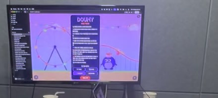

## AI 시대, 나는 어떤 일을 하게 될까?

부제는 "AI라는 파도, 무서워하지 말고 올라타자!"였어요. 이야기는 도구가 바뀌어 온 흐름에서 시작했어요. 사람이 쓰는 도구는 계속 바뀌어 왔고 바뀔 때마다 조금씩 쉽고 빨라졌어요. 그러다 결국에는 말로 하게 돼요.

새 도구가 나오면 그 위에서 새로운 일이 생겨요. 그렇다면 AI 위에서는 어떤 일이 생길까요? "AI + 내가 좋아하는 것"을 합쳐서 아직 세상에 없는 일을 상상해 보기도 했어요.

도구가 바뀌어도 그대로인 것도 있어요. 이야기를 좋아하는 마음, 놀고 싶은 마음은 담기는 그릇만 달라졌을 뿐 늘 사람 곁에 있었어요. 그 마음을 채워 주는 일은 AI 시대에도 계속 남아요.

힘이나 계산, 기억으로 겨루면 사람은 기계를 이길 수 없어요. 그러니 기계와 겨루지 말고 기계를 부리는 사람이 되자고 했어요.

AI 시대의 일도 세 갈래로 나눠 봤어요. 컴퓨터 앞에서 되풀이하는 일은 AI가 대신하기 쉬워요. 요리하고, 고치고, 돌보고, 키우는 것처럼 몸으로 하는 일은 AI가 대신하기 어려워요. 그래서 잘 먹고, 운동하고, 잘 자는 것도 미래를 위한 준비라는 이야기가 나왔어요. 마지막 갈래는 AI를 부려서 세상에 없는 것을 만들고 귀찮은 일을 자동으로 하게 만드는 일이에요. 가장 신나는 길이라고 했어요.

AI가 못 하는 사람만의 힘도 꼽아 봤어요. 질문하는 힘, 상상하는 힘, 정하는 힘, 그리고 마음. AI에게 일을 잘 시키려면 말과 글을 잘 다루고 스스로 생각할 줄 알아야 해서 책을 읽는 일이 더 중요해진다는 이야기로 이어졌어요. 마지막 말은 "책을 읽고, 질문하고, 만들어 봐!"였어요.

## 오늘의 수업 흐름

1. 슬라이드로 AI 시대의 일 이야기를 나눴어요.
2. AI에게 일 시키는 법을 연습했어요. 원하는 것을 자세하게 말할수록 AI가 더 잘 알아듣는다는 것을 아이들이 직접 해 보면서 익혔어요.
3. 팀 회의로 만들 게임을 정하고 AI와 함께 만들었어요.

AI를 부려서 세상에 없던 것을 만들어 보자는 이야기를, 수업 안에서 바로 해 본 셈이에요.

## 🚀 Doumy

### 아이들이 만든 것

세 아이가 각자 아이디어를 내고 모두가 동의한 게임으로 정했어요. 이름은 DOUMY(더미)예요.

괴물 '더미'의 명치를 돌로 맞히는 게임이에요. 두 사람이 번갈아 가며 돌을 던져요.

화면 가운데에는 DOUMY 로고와 글 상자가 있고, 그 아래에 빨간 버튼이 있어요. 펭귄을 닮은 캐릭터도 보여요. 배경은 여러 가지예요. 대관람차와 롤러코스터가 있는 놀이공원, 창문에 불이 켜진 빌딩 숲, 달이 뜬 보라색 밤하늘이 나와요.

만드는 동안 아이들은 번갈아 가며 AI에게 "이렇게 바꿔 줘"라고 요청했고 그렇게 게임이 조금씩 커졌어요. 끝나기 30분 전에는 각자 마지막 의견을 하나씩 넣어 게임을 확정했어요. 마지막 20분은 다 같이 플레이하면서 확인했어요.

## 숙제

이번 주 숙제는 타자 연습이에요. 아이들이 모두 아직 독수리 타법으로 글자를 치고 있어서 내 준 숙제예요. 독수리 타법은 손가락 몇 개로 자판을 하나씩 찾아 누르는 방법을 말해요.
