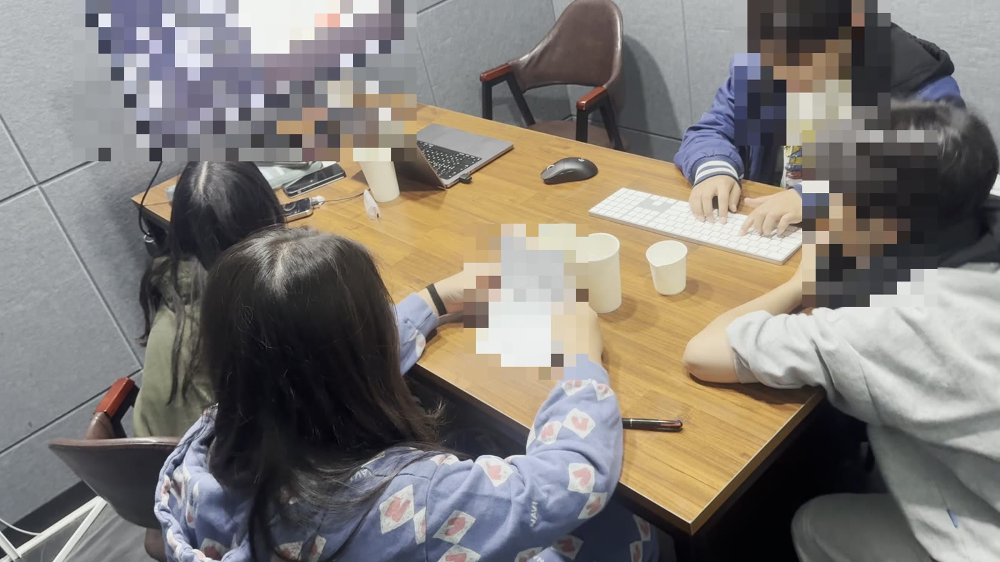

## 컴퓨터는 어떻게 생각할까?

게임도 하고 그림도 그리고 AI와 이야기도 나누는 컴퓨터가 속으로는 어떻게 일하는지 알아봤어요. 컴퓨터 안에는 생각하는 두뇌인 CPU, 지금 쓰는 것을 펼쳐 두는 책상 같은 메모리, 오래 보관하는 책장 같은 디스크, 그림을 맡는 GPU가 있어요.

컴퓨터가 아는 것은 0과 1뿐이에요. 전기 신호가 있으면 1, 없으면 0이에요. 글자도 그림도 소리도 모두 0과 1로 바꿔서 다뤄요. 게임을 켜면 디스크에 있던 게임이 메모리로 올라오고, CPU가 계산하고, GPU가 화면을 그려요.

우리가 AI에게 쓴 질문도 0과 1로 바뀌어 데이터센터의 컴퓨터에서 계산돼요. 매주 함께 게임을 만드는 AI도 결국 이런 컴퓨터 위에서 움직이고 있는 거예요.

## 오늘의 수업 흐름

- 컴퓨터와 AI에 관한 팀 퀴즈를 풀었어요.
- 지난주에 만든 게임에 AI가 고친 내용이 잘 들어갔는지 직접 해 보며 확인했어요.
- AI가 게임을 고치는 동안 컴퓨터가 어떻게 생각하는지 이론 수업을 들었어요.
- 게임을 어떻게 더 키울지 이야기하고 정했어요.

이날은 요즘 AI 뉴스도 함께 살펴봤어요.

## ⭐ Wanted

### 학생들이 만든 것

지난주에 세 번째 버전까지 만든 게임 「현상수배 킬러」를 이어서 키웠어요.

먼저 AI가 바꾼 내용이 요청한 대로 들어갔는지 학생들이 한 명씩 직접 플레이하며 확인했어요. 체력 수치, 무기, 맵을 살펴봤어요.

아래 영상은 수업이 끝난 뒤 지금의 게임을 플레이해 녹화한 화면이에요.



해 보니 부탁한 것과 다르게 만들어진 곳이 있었어요. 체력 수치가 생각과 달랐고 이동 키가 WASD가 아니라 화살표 키로 되어 있었어요. 이동 키는 수업 중에 WASD로 고쳤어요. 게임이 너무 쉬워졌다는 이야기도 나왔어요. 미니건의 피해가 부족했고 보스 체력도 생각했던 것과 달랐어요.

선생님은 「잘」처럼 흐릿하게 말하면 AI가 알아듣기 어려울 수 있으니 숫자로 말하는 게 좋다고 설명했어요. 학생들은 일반 수배범, 보스, 최종 보스의 체력을 숫자로 정해서 AI에게 다시 부탁했어요.

앞으로 게임을 어떻게 키울지도 이야기했어요. 혼자 하는 게임을 팀원 모두가 함께 범죄자를 잡는 협동 모드로 바꾸기로 했고 스테이지가 많아지면(최대 100개) 세 개의 세계로 나누기로 했어요. 캐릭터와 범죄자의 모습은 더 자세하고 다양하게, 범죄자 이름도 다양하게 하자는 이야기가 나왔어요. 레이저나 번개 망치 같은 무기 효과, 무기 상점, 특별한 능력을 가진 최종 보스와의 싸움도 이야기했어요. 마지막 수업에서는 QR 코드로 휴대폰에서 다 같이 해 보자는 이야기도 나왔어요.
