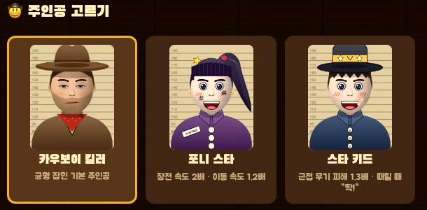

## 그림을 보여 주며 게임을 함께 키워 가요

게임 「현상수배 킬러」를 지난주에 이어 이번 주에도 고쳤어요. 고치고 싶은 점을 AI에게 하나씩 부탁해 게임에 반영했어요.

이번에는 글로만 부탁하지 않고 그림도 함께 보여 줬어요. 화이트보드에 그린 가게 그림 사진과 캐릭터 그림을 보내자, AI가 그 그림을 바탕으로 게임 속 배경과 주인공을 새로 그렸어요.

## 오늘의 수업 흐름

- 화이트보드에 그린 가게 그림 사진을 보내 새 배경을 부탁했어요.
- 기본 권총의 피해와 시간이 다 됐을 때 보스가 회복하는 규칙을 정해 부탁했어요.
- 주인공을 고를 수 있게 해 달라고 하며 남자아이 그림을 보냈어요.
- 여자 캐릭터 그림을 보내 주인공을 하나 더 늘렸어요.
- 고르는 화면을 줄이고 스킬 세 가지를 더해 달라고 부탁했어요.

## ⭐ Wanted

### 학생들이 만든 것

학생들은 이번 주에 AI에게 여러 가지 요청을 보내며 게임을 고쳤어요.

먼저 화이트보드에 그린 가게 그림 사진으로 배경을 부탁했어요. 그 결과 School Shop, Cafe, Wanted 24 간판이 늘어선 「우리 동네 가게」라는 새 맵이 생겼어요.

싸움 규칙도 손봤어요. 기본 권총의 피해를 10에서 12로 올렸고 제한 시간이 지나면 상대가 남은 체력의 절반을 회복하도록 했어요.

주인공도 고를 수 있게 됐어요. 홈 화면에 「주인공 고르기」가 생겼고 원래 있던 카우보이 킬러에 두 주인공이 더해졌어요. 남자아이 그림을 바탕으로 한 스타 키드는 가까이에서 때리는 무기의 피해가 1.3배이고 때릴 때 「딱!」 글자가 떠요. 여자 캐릭터 그림을 바탕으로 한 포니 스타는 장전이 2배, 움직임이 1.2배 빨라요. 포니 스타는 AI가 지은 이름이라, 학생들이 붙인 이름이 있으면 바꾸겠다고 AI가 말했어요. 두 주인공은 보낸 그림이 그대로 들어간 것이 아니라, 그림을 바탕으로 AI가 새로 그린 모습이에요.

마지막으로 무기와 맵을 고르는 화면을 한 화면에 들어오도록 줄이고 스킬 세 가지를 더했어요. Q는 상대를 3초 동안 기절시키고, E는 무적 상태로 빠르게 움직이는 대쉬, F는 상대의 명중률과 공격력을 낮추는 실명이에요.

아래 영상은 수업이 끝난 뒤 지금의 게임을 플레이해 녹화한 화면이에요. 주인공과 맵, 스킬은 녹화할 때 고른 것이에요.



AI는 고친 뒤에 학생들에게 몇 가지를 물어봤어요. 시간 초과 때 회복을 남은 체력이 아니라 최대 체력의 절반으로 할지, 제한 시간과 회복 규칙을 보스에게만 적용할지, 실명 스킬이 공격력까지 줄이게 둘지 같은 것들이에요. 아직 정하지 않았어요.
